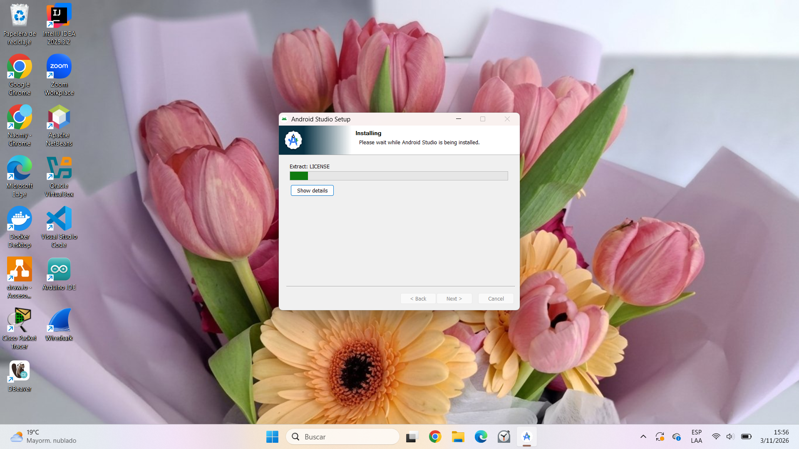
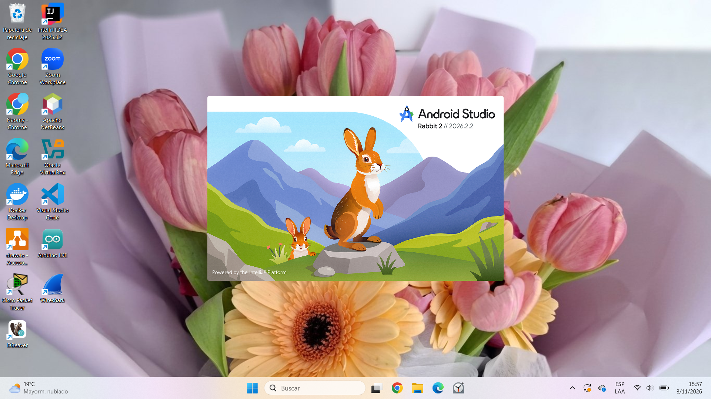
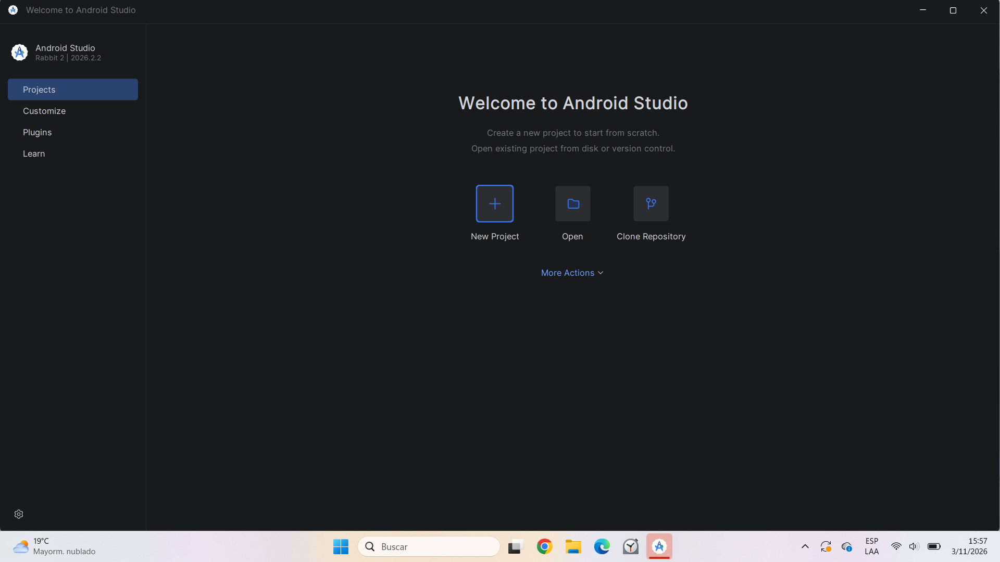
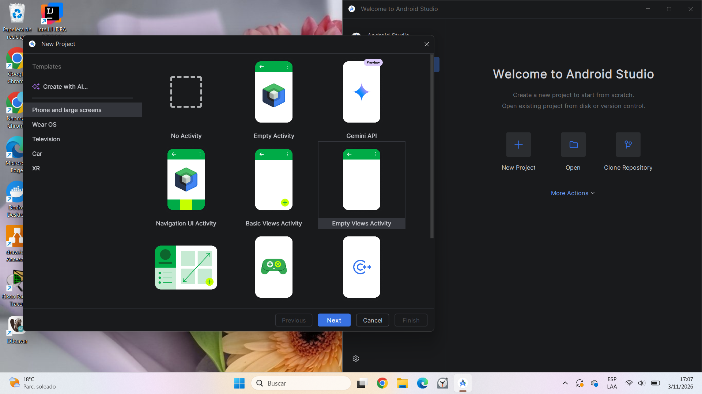
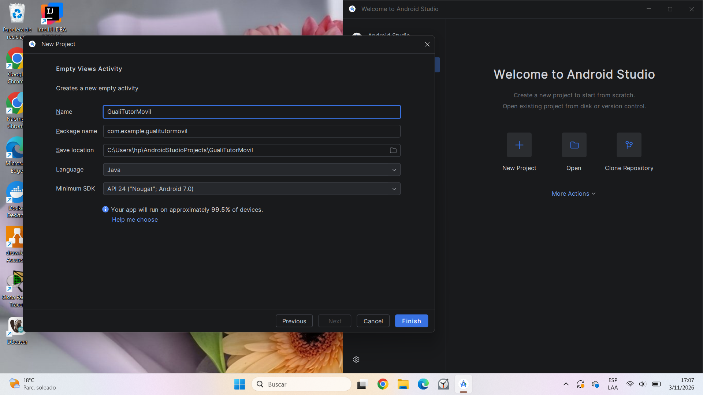
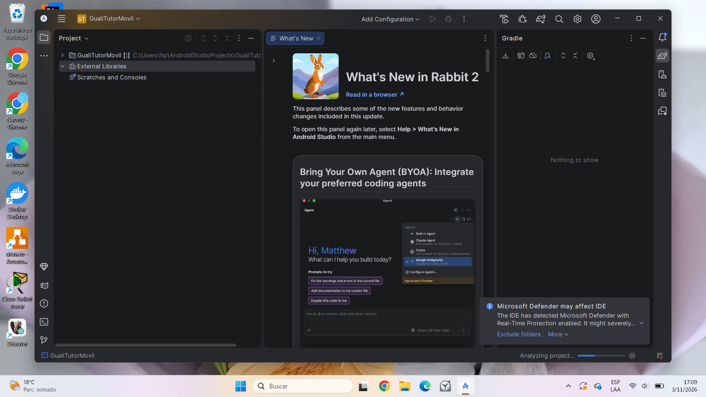
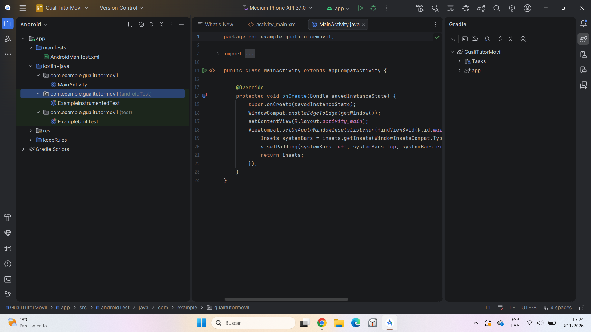

# Guali Tutor Móvil: crear el front end de una app Android paso a paso

Este tutorial explica cómo construir, con Android Studio y Java, la interfaz principal de Guali Tutor, una aplicación para practicar programación con lecciones cortas. La pantalla incluye los elementos del diseño original: barra de menú, título de la lección activa, panel de lección, editor de código, botones de acción y consola.

Esta fase solo contiene la interfaz (front end). Los botones no tienen funcionalidades.

**Autor:** [TU NOMBRE COMPLETO] — **Carné:** [####-##-###]

## Contenido

1. Prerrequisitos
2. Instalar Android Studio
3. Crear el proyecto
4. Abrir el archivo de diseño
5. Construir la pantalla
6. Ver el resultado
7. Estructura final y código fuente

## 1. Prerrequisitos

| Requisito | Detalle |
|---|---|
| Sistema operativo | Windows 10 u 11 (64 bits) |
| Memoria RAM | 8 GB como mínimo (conviene cerrar otros programas mientras se trabaja) |
| Espacio en disco | Unos 10 GB libres para Android Studio y el SDK |
| Internet | Necesario para descargar Android Studio y las dependencias |
| Conocimientos | Java básico y nociones de XML |

No hace falta instalar un JDK aparte: Android Studio incluye el suyo.

## 2. Instalar Android Studio

**Paso 2.1** Entra a la página oficial <https://developer.android.com/studio> y descarga el instalador para Windows.

**Paso 2.2** Ejecuta el instalador. Deja las opciones por defecto (Android Studio, Android SDK y Android Virtual Device) y avanza con **Next** hasta **Finish**.





**Paso 2.3** Al abrir Android Studio por primera vez aparece un asistente de configuración. Elige la instalación **Standard** y acepta las licencias. Descargará el SDK, tarda unos minutos y no hay que cerrarlo.

Al terminar se muestra la pantalla de bienvenida con **New Project**, **Open** y **Clone Repository**.



## 3. Crear el proyecto

**Paso 3.1** En la pantalla de bienvenida pulsa **New Project**.

**Paso 3.2** En **Phone and Tablet**, elige la plantilla **Empty Views Activity** (diseño clásico con XML, no Jetpack Compose) y pulsa **Next**.



**Paso 3.3** Llena la configuración:

| Campo | Valor |
|---|---|
| Name | GualiTutorMovil |
| Package name | com.example.gualitutormovil |
| Save location | Una carpeta corta, sin espacios |
| Language | Java |



**Paso 3.4** Pulsa **Finish** y espera. La primera vez, Gradle descarga dependencias y la barra de progreso de la parte inferior indica que sigue trabajando. No cierres el programa hasta que termine.



> **Nota sobre "kotlin+java":** en la vista *Android* del árbol, la carpeta de código se llama `kotlin+java`. Es solo el nombre con que Android Studio agrupa las fuentes; el código de este proyecto es Java (`MainActivity`). Los archivos `.kts` son la configuración de compilación.

## 4. Abrir el archivo de diseño

**Paso 4.1** En el árbol del proyecto abre `app → res → layout → activity_main.xml` con doble clic.

**Paso 4.2** En la esquina superior derecha del editor elige la vista **Code**, que muestra el XML. Selecciona todo el contenido (`Ctrl + A`) y bórralo.



## 5. Construir la pantalla

Se construye por partes. Cada paso agrega un bloque dentro del contenedor principal.

### Paso 5.1 Contenedor principal

Un `LinearLayout` vertical hace que los elementos se apilen de arriba hacia abajo. Escribe esto:

```xml
<?xml version="1.0" encoding="utf-8"?>
<LinearLayout xmlns:android="http://schemas.android.com/apk/res/android"
    android:id="@+id/main"
    android:layout_width="match_parent"
    android:layout_height="match_parent"
    android:orientation="vertical">

    <!-- Aquí van los bloques de los siguientes pasos -->

</LinearLayout>
```

### Paso 5.2 Barra de menú

Cuatro botones sin relleno que se reparten el ancho por igual (`layout_weight="1"`). Pega este bloque dentro del contenedor, antes de la etiqueta `</LinearLayout>` del final:

```xml
    <!-- Barra de menú -->
    <LinearLayout
        android:layout_width="match_parent"
        android:layout_height="wrap_content"
        android:background="#0F172A"
        android:orientation="horizontal">

        <Button
            style="?android:attr/borderlessButtonStyle"
            android:layout_width="0dp"
            android:layout_height="wrap_content"
            android:layout_weight="1"
            android:text="Lecciones"
            android:textAllCaps="false"
            android:textSize="12sp" />

        <Button
            style="?android:attr/borderlessButtonStyle"
            android:layout_width="0dp"
            android:layout_height="wrap_content"
            android:layout_weight="1"
            android:text="Configuración"
            android:textAllCaps="false"
            android:textSize="12sp" />

        <Button
            style="?android:attr/borderlessButtonStyle"
            android:layout_width="0dp"
            android:layout_height="wrap_content"
            android:layout_weight="1"
            android:text="Historial"
            android:textAllCaps="false"
            android:textSize="12sp" />

        <Button
            style="?android:attr/borderlessButtonStyle"
            android:layout_width="0dp"
            android:layout_height="wrap_content"
            android:layout_weight="1"
            android:text="Ayuda"
            android:textAllCaps="false"
            android:textSize="12sp" />
    </LinearLayout>
```

### Paso 5.3 Título de lección activa

Una etiqueta negra con el texto "LECCIÓN ACTIVA" y, a su lado, el nombre de la lección:

```xml
    <!-- Título: lección activa -->
    <LinearLayout
        android:layout_width="match_parent"
        android:layout_height="wrap_content"
        android:orientation="horizontal">

        <TextView
            android:layout_width="wrap_content"
            android:layout_height="wrap_content"
            android:background="#000000"
            android:padding="8dp"
            android:text="LECCIÓN ACTIVA"
            android:textColor="#FFFFFF"
            android:textSize="12sp" />

        <TextView
            android:layout_width="match_parent"
            android:layout_height="wrap_content"
            android:padding="8dp"
            android:text="leccion-01-hola-mundo"
            android:textSize="14sp" />
    </LinearLayout>
```

### Paso 5.4 Panel de lección activa

Una imagen arriba y, debajo, la descripción con desplazamiento (`ScrollView`) por si el texto es largo. Con `layout_height="0dp"` y `layout_weight="1"` el panel ocupa el espacio sobrante:

```xml
    <!-- Panel de lección activa: imagen y descripción -->
    <LinearLayout
        android:layout_width="match_parent"
        android:layout_height="0dp"
        android:layout_weight="1"
        android:orientation="vertical"
        android:padding="8dp">

        <ImageView
            android:layout_width="match_parent"
            android:layout_height="90dp"
            android:background="#ECEFF4"
            android:contentDescription="Imagen de la lección"
            android:src="@android:drawable/ic_menu_gallery" />

        <ScrollView
            android:layout_width="match_parent"
            android:layout_height="0dp"
            android:layout_marginTop="8dp"
            android:layout_weight="1"
            android:background="#FAFAFA">

            <TextView
                android:layout_width="match_parent"
                android:layout_height="wrap_content"
                android:padding="8dp"
                android:text="Descripción de la lección activa" />
        </ScrollView>
    </LinearLayout>
```

### Paso 5.5 Editor de código

Un `EditText` de varias líneas con fuente monoespaciada, donde el estudiante escribirá su código:

```xml
    <!-- Editor de código -->
    <EditText
        android:layout_width="match_parent"
        android:layout_height="0dp"
        android:layout_marginStart="8dp"
        android:layout_marginEnd="8dp"
        android:layout_weight="1"
        android:background="#F5F5F5"
        android:fontFamily="monospace"
        android:gravity="top|start"
        android:hint="Escriba aquí su código Java"
        android:importantForAutofill="no"
        android:inputType="textMultiLine|textNoSuggestions"
        android:padding="8dp"
        android:textSize="13sp" />
```

### Paso 5.6 Botones de acción

**Compilar** (gris) y **Ejecutar** (verde), centrados:

```xml
    <!-- Botones de acción -->
    <LinearLayout
        android:layout_width="match_parent"
        android:layout_height="wrap_content"
        android:gravity="center"
        android:orientation="horizontal"
        android:padding="4dp">

        <Button
            android:layout_width="wrap_content"
            android:layout_height="wrap_content"
            android:layout_marginEnd="16dp"
            android:backgroundTint="#757575"
            android:text="Compilar" />

        <Button
            android:layout_width="wrap_content"
            android:layout_height="wrap_content"
            android:backgroundTint="#4CAF50"
            android:text="Ejecutar" />
    </LinearLayout>
```

### Paso 5.7 Panel de consola

Un área oscura de altura fija (110 dp) para mostrar la salida de compilación y ejecución. Este es el último bloque; el `</LinearLayout>` del final ya lo escribiste en el paso 5.1:

```xml
    <!-- Panel de consola -->
    <ScrollView
        android:layout_width="match_parent"
        android:layout_height="110dp"
        android:layout_margin="8dp"
        android:background="#212121">

        <TextView
            android:layout_width="match_parent"
            android:layout_height="wrap_content"
            android:fontFamily="monospace"
            android:padding="8dp"
            android:text="Salida de la consola..."
            android:textColor="#C8E6C9"
            android:textSize="12sp" />
    </ScrollView>
```

## 6. Ver el resultado

**Opción A: vista previa del editor.** Cambia a la vista **Split** (o **Design**) en la esquina superior derecha. A la derecha aparece la pantalla del teléfono con todos los elementos.

**Opción B: ejecutar en el emulador (opcional).** Arriba selecciona el dispositivo (por ejemplo *Medium Phone*) y pulsa el botón verde **Run**. La primera vez descarga la imagen del emulador y puede tardar. Con 8 GB de RAM puede ir lento: se recomienda cerrar otros programas o usar un teléfono real con la depuración por USB activada.


## 7. Estructura final y código fuente

```
GualiTutorMovil/
└── app/
    └── src/main/
        ├── java/com/example/gualitutormovil/MainActivity.java
        ├── res/layout/activity_main.xml      <- toda la interfaz
        └── AndroidManifest.xml
```

El diseño completo está en [`activity_main.xml`](GualiTutorMovil/app/src/main/res/layout/activity_main.xml) de este repositorio.

### Resumen de elementos

| Elemento | Componente de Android |
|---|---|
| Barra de menú | `LinearLayout` horizontal con 4 `Button` |
| Título de lección activa | `LinearLayout` con 2 `TextView` |
| Panel de lección activa | `ImageView` + `ScrollView` con `TextView` |
| Editor de código | `EditText` multilínea, fuente monoespaciada |
| Botones de acción | 2 `Button` (Compilar y Ejecutar) |
| Panel de consola | `ScrollView` con `TextView` |

El proyecto de Android Studio con el código completo está en este mismo repositorio.
